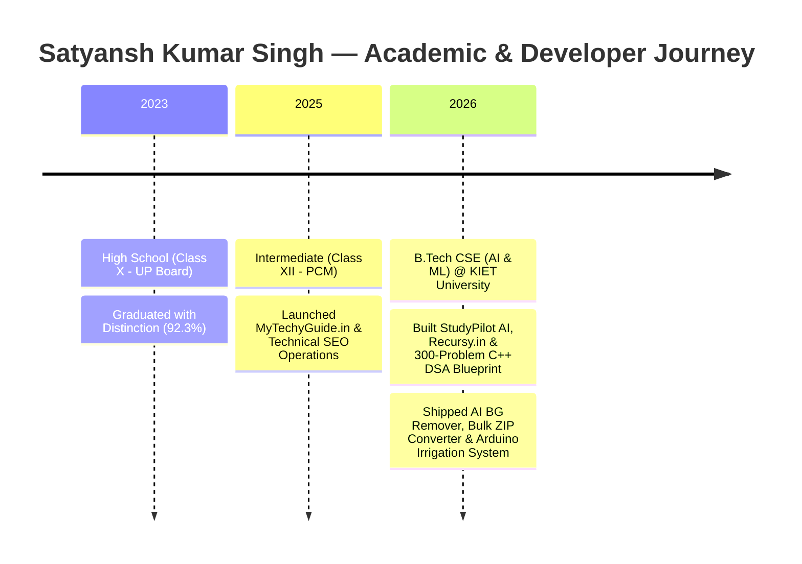

<div align="center">

<!-- Animated SVG Typing Header -->
<a href="https://recursy.in">
  
</a>

<p align="center">
  <b>An ultra-modern, dark neon-purple personal portfolio engineered with semantic HTML5, custom CSS3 glassmorphism, and Vanilla JavaScript.</b><br>
  <sub>Built to showcase Full Stack SaaS products, 300+ C++ DSA patterns, client-side AI utilities, and IoT prototypes.</sub>
</p>

<!-- Interactive Badges -->
<p align="center">
  <a href="https://vercel.com"></a>
  <a href="#-featured-projects-interactive-deep-dive"></a>
  <a href="#-education--work-timeline"></a>
  <a href="#-tech-stack--arsenal"></a>
</p>

<!-- Quick Jump Navigation Pills -->
<h4>
  <a href="#-live-preview--ui-highlights">✨ UI Highlights</a> &nbsp;&bull;&nbsp;
  <a href="#-featured-projects-interactive-deep-dive">🚀 Interactive Projects</a> &nbsp;&bull;&nbsp;
  <a href="#-tech-stack--arsenal">🛠️ Tech Stack</a> &nbsp;&bull;&nbsp;
  <a href="#-architecture--file-structure">📂 Architecture</a> &nbsp;&bull;&nbsp;
  <a href="#-1-minute-deployment-guide">⚡ Quick Deploy</a> &nbsp;&bull;&nbsp;
  <a href="#-connect-with-satyansh">🤝 Contact</a>
</h4>

</div>

---

## 🌌 Live Preview & UI Highlights

This portfolio replicates a high-contrast **Obsidian & Electric Violet (`#05030a` + `#8b5cf6`)** aesthetic with zero heavy framework overhead.

| 🎨 Visual & UX Feature | ⚡ Technical Implementation |
| :--- | :--- |
| **Glowing Cursor Follower** | Real-time `mousemove` coordinates paired with `mix-blend-mode: screen` and hardware-accelerated CSS transitions. |
| **Portrait Aura & Live Photo Switcher** | Pulsing radial-gradient backlight with `FileReader()` API integration to test custom profile photos directly in the browser. |
| **Interactive Timeline Switcher** | Pill-tab state machine toggling smoothly between **Work Experience** and **Education** with a central glowing axis. |
| **Collapsible Service Accordions** | Smooth height & opacity transitions showcasing categorized **Developer** and **Design & SEO** skill tags. |
| **One-Click Clipboard Copy** | Instant `navigator.clipboard` email copy with live `"Email copied ✓"` state feedback. |

---

## 🚀 Featured Projects (Interactive Deep Dive)

> 💡 **Click on any project below** to expand its full architecture, features, and tech stack!

<details open>
<summary><b>01. 🧠 StudyPilot — Smart AI Study Companion & EdTech SaaS</b> <i>(Click to collapse/expand)</i></summary>
<br>

- **Category:** AI Web Application / EdTech Platform
- **Overview:** A dark-themed AI productivity suite tailored for students to streamline exam preparation, note summarization, and active recall.
- **Key Features:**
  - 📄 **Smart Summaries:** Condenses lengthy lectures and PDFs into structured revision bullets.
  - ❓ **AI Quiz Generator:** Dynamically generates MCQs and self-assessment flashcards.
  - 💬 **Interactive Study Chatbot:** Context-aware AI tutor for instant doubt resolution.
- **Tech Stack:** `React.js`, `Node.js`, `Gemini AI API`, `Tailwind CSS`, `Vercel`

</details>

<details>
<summary><b>02. 💻 Recursy.in — CS Productivity Hub & 300-Problem C++ DSA Blueprint</b> <i>(Click to expand)</i></summary>
<br>

- **Category:** Full Stack Platform & Algorithmic Curriculum
- **Overview:** A dedicated ecosystem for Computer Science students featuring a structured **300-Problem C++ DSA Master Blueprint** organized across **15 core topics** and **52 algorithmic patterns**.
- **Key Features:**
  - 📊 Pattern-wise progress tracking (Two Pointers, Sliding Window, Binary Search, DP, Graphs, Tries).
  - ⚡ Clean dark-mode reading experience with complexity analysis ($O(N)$ time & space breakdowns).
- **Tech Stack:** `Next.js`, `HTML5`, `CSS3`, `JavaScript`, `C++ STL`, `GitHub`
- **Live Domain:** [recursy.in](https://recursy.in)

</details>

<details>
<summary><b>03. 🖼️ AI Background Remover & 100-File Bulk Image Converter</b> <i>(Click to expand)</i></summary>
<br>

- **Category:** High-Speed Client-Side Web Utilities
- **Overview:** Privacy-first browser utilities engineered for instant media processing without server bottlenecks.
- **Key Features:**
  - ✂️ **AI Background Remover:** Automated subject segmentation with transparent PNG export.
  - 📦 **Bulk JPG-to-PNG Converter:** Processes up to **100 images simultaneously** using the HTML5 Canvas API and packages them into a single one-click `.zip` download via `JSZip`.
- **Tech Stack:** `HTML5 Canvas`, `Vanilla JavaScript`, `JSZip API`, `Vision AI API`, `CSS3`

</details>

<details>
<summary><b>04. 📈 MyTechyGuide.in & Smart Arduino Soil Irrigation IoT</b> <i>(Click to expand)</i></summary>
<br>

- **Category:** Technical SEO Publishing & Hardware-Software IoT
- **Overview:** Combines high-traffic digital publishing with embedded microcontroller automation.
- **Key Features:**
  - 🔍 **MyTechyGuide.in & Jagohindi:** End-to-end WordPress architecture, BigRock DNS management, and technical SEO audits powered by **Ahrefs**.
  - 🌱 **Smart Soil Irrigation System:** Automated water pump controller built with **Arduino C++**, calibrated soil moisture sensors, and a 5V relay module.
- **Tech Stack:** `WordPress`, `Ahrefs SEO`, `Arduino C++`, `IoT Sensors & Relays`
- **Live Domain:** [mytechyguide.in](https://mytechyguide.in)

</details>

---

## 🛠️ Tech Stack & Arsenal

<div align="center">

### **Frontend & UI Engineering**


### **Backend, Programming & Hardware**
-00599C?style=for-the-badge&logo=c%2B%2B&logoColor=white)


### **SEO, Cloud & Developer Tools**


</div>

---

## 🎓 Education & Work Timeline



---

## 📂 Architecture & File Structure

```text
📦 satyansh-portfolio
 ┣ 📜 index.html        # Semantic HTML5 layout (Hero, Projects, Timeline, Services, Reviews, Contact)
 ┣ 🎨 style.css         # Custom CSS variables, neon-purple radial glows, timeline & responsive grid
 ┣ ⚡ index.js          # Cursor tracker, tab state switcher, accordion logic & clipboard API
 ┣ 🖼️ profile.jpg       # Personal portrait image (auto-falls back to dev avatar if missing)
 ┗ 📖 README.md         # Interactive documentation
```

---

## ⚡ 1-Minute Deployment Guide

<details>
<summary><b>🔹 Option 1: Run Locally on Your Machine</b></summary>

1. **Clone the repository:**
   ```bash
   git clone https://github.com/your-username/satyansh-portfolio.git
   cd satyansh-portfolio
   ```
2. **Add your photo:**
   Save your portrait photo as `profile.jpg` in the root folder.
3. **Launch:**
   Open `index.html` directly in your browser or use the **VS Code Live Server** extension.
</details>

<details>
<summary><b>🔹 Option 2: Deploy to Vercel (Recommended)</b></summary>

1. Push your code to a new GitHub repository.
2. Go to [vercel.com/new](https://vercel.com/new) and import your repository.
3. Leave the build settings as default (Static HTML) and click **Deploy**.
4. Your portfolio will be live on a global CDN in under 30 seconds!
</details>

<details>
<summary><b>🔹 Option 3: Deploy to GitHub Pages</b></summary>

1. Open your repository on GitHub.
2. Navigate to **Settings** → **Pages**.
3. Under **Build and deployment**, select the `main` branch and `/ (root)` folder.
4. Click **Save** — your live link will appear at `https://<your-username>.github.io/<repo-name>/`.
</details>

---

## 🎨 Color Palette Reference

| Color Role | Hex Code | Preview |
| :--- | :--- | :--- |
| **Obsidian Background** | `#05030a` | `rgb(5, 3, 10)` |
| **Deep Card Surface** | `#0c0918` | `rgb(12, 9, 24)` |
| **Electric Violet Primary** | `#8b5cf6` | `rgb(139, 92, 246)` |
| **Neon Lavender Glow** | `#a78bfa` | `rgb(167, 139, 250)` |
| **Muted Slate Text** | `#9ca3af` | `rgb(156, 163, 175)` |

---

## 🤝 Connect With Satyansh

<div align="center">

[](https://linkedin.com)
[](https://github.com)
[](https://recursy.in)
[](https://mytechyguide.in)

<br>

**⭐ If you like this portfolio design, don't forget to star the repository!**

<sub>Designed & Engineered with ❤️ and C++ logic by <b>Satyansh Kumar Singh</b> &bull; © 2026</sub>

</div>
